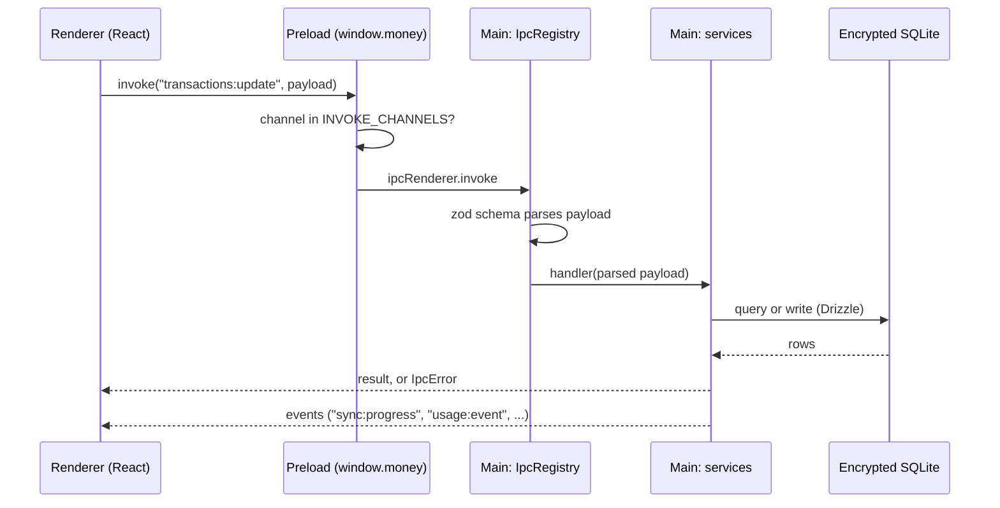

# Architecture

For contributors. Users should read the [user guide](user-guide/README.md).

Money is an Electron app for macOS. It is local-first: there is no server. The database, the secrets and the models' inputs stay on the user's Mac.

## Process model

| Process | Code | Job |
|---|---|---|
| Main | `src/main/` | Owns the database, the Keychain, Plaid, the model calls, the scheduler and the updater. Runs all logic. |
| Preload | `src/preload/index.ts` | The only bridge. Exposes `window.money` with `invoke` and `on`. |
| Renderer | `src/renderer/` | React 19 UI. Untrusted. It holds no secrets and cannot reach Node. |

`contextIsolation` is on and `nodeIntegration` is off (`src/main/index.ts`). `sandbox` is off because Electron loads an ESM preload only that way.

Shared types, zod schemas and the feature catalog live in `src/shared/`. Both sides import them.

## IPC

- **Allowlist.** `INVOKE_CHANNELS` and `EVENT_CHANNELS` in `src/preload/index.ts` list every channel. The bridge rejects any other name. There is no generic passthrough. `tests/unit/ipc/preload-allowlist.test.ts` checks that the list matches the handlers.
- **Registry.** `src/main/ipc/registry.ts` holds `IpcRegistry`. `handle(channel, schema, handler)` validates every payload on the main side. A bad payload fails with `VALIDATION_FAILED`. Errors cross the bridge as `IpcError` (`code`, `message`, `recoverable`).
- **Handlers.** `src/main/ipc/handlers/index.ts` registers channels. `src/main/ipc/handlers/services.ts` defines the service interface. `src/main/services/index.ts` implements it.
- **Renderer side.** `src/renderer/lib/ipc.ts` provides `call` and `useQuery`.
- **Add a channel.** Write its zod schema in `src/shared/schemas.ts`. Register it. Add it to `INVOKE_CHANNELS`. Add it to the catalog in `src/shared/features.ts`.

## Database and migrations

- Driver: `better-sqlite3-multiple-ciphers`, default cipher ChaCha20-Poly1305. ADR 0001 records why. ORM: Drizzle. Schema: `src/main/db/schema.ts`.
- `src/main/db/client.ts` opens the file. `PRAGMA key` is the first statement. `temp_store` is `MEMORY`, so temporary tables never touch the disk unencrypted. The journal mode is WAL. The first read checks the key.
- Migrations are SQL files in `src/main/db/migrations/`, run by `src/main/db/migrate.ts`. `npm run build` copies them into the bundle.
- **Migrations run with foreign keys off.** SQLite ignores `PRAGMA foreign_keys` inside a transaction. A table rebuild runs `DROP TABLE`. With foreign keys on, that `DROP TABLE` would delete child rows by cascade. `runMigrations` turns the pragma off, migrates, and turns it on again in a `finally` block.
- Money is stored as integer minor units. It is never a float.

## Secrets and the Keychain

`src/main/secrets/secret-store.ts` defines `SecretStore` and `KeychainSecretStore` (`@napi-rs/keyring`). Each secret is its own Keychain item under the service `com.atavares.money`. Dev and test profiles use `com.atavares.money.dev.<hash>`, so they never read real secrets.

| Account name | Secret |
|---|---|
| `database-key` | The SQLCipher key (256-bit, hex) |
| `plaid-client-id`, `plaid-secret` | Plaid credentials |
| `anthropic-api-key` | Claude key |
| `plaid-access-token:<institutionId>` | One per connected bank |

The renderer never receives a secret. `src/main/secrets/availability.ts` stops the app at startup when the OS cannot encrypt. There is no plaintext fallback. `tests/e2e/secret-audit.spec.ts` checks that the built renderer bundle holds no secret.

## Categorization

`src/main/categorization/pipeline.ts` runs two stages. Local history first. The model only for what history cannot resolve. A merchant the user confirmed never reaches a model.

Precedence, strongest first:

1. One-off override on the transaction.
2. Merchant rule.
3. History (the user's past corrections).
4. Model (`ollama.ts`, `model.ts` for Claude), or heuristics when no model is set.
5. The imported value from the bank.

Low-confidence results set `needsReview`, and the Review screen shows them. Providers: `ollama`, `anthropic`, `local_only`. `factory.ts` builds the classifier from settings. A model failure falls back to local heuristics, which is why Settings has "Test the model".

## Sync

- `src/main/plaid/sync.ts` and `src/main/sync/engine.ts` call Plaid `/transactions/sync` and apply each page (`src/main/ingestion/apply.ts`), detect transfers, categorize, and evaluate alerts.
- Polling, not webhooks. ADR 0004 records why. `src/main/index.ts` polls every 60 minutes.
- On launch, `src/main/scheduler/catchup.ts` plans a catch-up: a sync, and any weekly digest or monthly report that is due. Correctness means complete catch-up, not uptime.
- Each attempt is recorded (`src/main/sync/record-attempt.ts`). Health reads this history.
- Imports from files use `src/main/import/` (CSV, QIF, QFX/OFX, duplicate detection, preview, commit).
- Analysis (`src/main/analysis/`) finds recurring charges, income, alerts and reports after each sync.

## Usage tracking

`src/shared/features.ts` is a closed catalog of feature ids. A usage event holds an id and nothing else, so no merchant name or amount can reach the `usage_events` table. `UsageRecorder` (`src/main/usage/recorder.ts`) writes events and prunes by the retention setting (`365` or `forever`).

**Coverage test.** `tests/unit/shared/features.test.ts` registers every handler against stub services. It fails when a channel is not in the catalog. It also fails when a screen id has no `view:` entry. So a new channel needs a catalog entry before the tests pass. Channels that start with `usage:` are not tracked.

## Design system

Tokens: `@theme` block in `src/renderer/styles.css`. Component styles: `src/renderer/design-system.css`. Components: `src/renderer/components/ui/`. Charts: `src/renderer/charts/`. Rules and tokens: [design-system.md](design-system.md). The live gallery is under **Dev › Design system** when you run `npm run dev`.

## Tests

| Layer | Where | Run |
|---|---|---|
| Unit | `tests/unit/` | `npm test` |
| Integration | `tests/integration/` (real encrypted database, backups, migrations, egress audit) | `npm test` |
| End to end | `tests/e2e/` (Playwright on the built app) | `npm run test:e2e` |
| Coverage gate | 80% | `npm run test:coverage` |
| Docs links | `tests/unit/docs/links.test.ts` | `npm test` |

- The e2e seed fixture is `tests/e2e/fixtures/seed.ts`. `seedExampleData` writes made-up accounts, transactions and recurring charges into the running app's database. It reads the database key from the Keychain inside the app process.
- `tests/e2e/helpers.ts` launches the built app (`out/main/index.js`) against a throwaway user-data directory and cleans its Keychain items.
- User-guide screenshots: `npm run docs:screenshots` runs `scripts/docs/screenshots.spec.ts`. It writes `docs/user-guide/img/`. It fails on a renderer error.
- Lint: `npm run lint`. Types: `npm run typecheck`.

## Release

Tag `v*` runs `.github/workflows/release.yml`. It builds, signs and notarizes the app and drafts a GitHub Release. Installed copies update themselves (`src/main/updates.ts`, every 6 hours and at launch). Steps are in [releasing.md](releasing.md).

## Decisions

- [ADR 0001](adr/0001-sqlcipher-driver-exception.md): the encrypted-SQLite driver.
- [ADR 0002](adr/0002-plaid-client-secret-on-device.md): the Plaid secret lives on the device.
- [ADR 0004](adr/0004-polling-over-webhooks.md): polling instead of webhooks.
- Specification: `specs/001-automated-spend-tracking/`.
