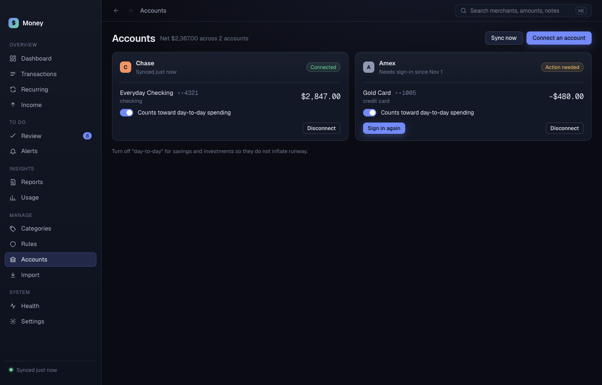

# Accounts

**Accounts** lists each connected bank with its accounts and balances. The header shows the net total across all accounts.

## Connect an account

1. Click **Connect an account**.
2. Sign in to your bank in the browser window that opens.
3. Return to Money. It updates on its own.

Money shows how many accounts it added. It imports your history in the background. If you wait too long, Money stops waiting and shows an error. Click **Connect an account** again.

Plaid Production allows 10 connected banks over the life of your Plaid account. See [Plaid setup](../plaid-setup.md).

## Sync now

Click **Sync now** to check for new transactions at once. Money shows what Plaid returned, including warnings.

## Choose which accounts count as day-to-day

Each account has a switch: **Counts toward day-to-day spending**.

- Leave it on for checking accounts and credit cards you spend from.
- Turn it off for savings and investments. They then do not inflate your runway or spending totals.

Accounts that Money creates from an import start with the switch off.

## Sign in again

A bank card with **Action needed** or **Sync failing** shows **Sign in again**. Some banks, such as American Express, ask you to sign in again from time to time.

1. Click **Sign in again**.
2. Sign in to your bank in the browser window.

Money syncs again after that. While an account needs you, Money marks every total that depends on it as incomplete.

## Disconnect a bank

Click **Disconnect** on the bank card. Money stops syncing that bank and deletes its accounts and all their transactions. Money asks for no confirmation, and this cannot be undone. Back up first if you want to keep the history. See [Settings](settings.md).
