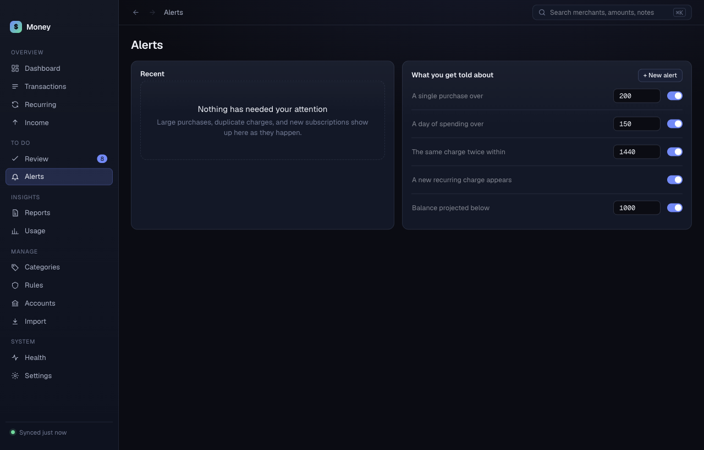

# Alerts

**Alerts** has two parts. **Recent** lists what Money told you about. **What you get told about** lists the rules that create alerts. A badge on the sidebar shows how many alerts are new.

## Read an alert

Each alert has a colored stripe, a title and a date. Alert titles are:

- **Large purchase**
- **Daily spending over the limit**
- **Possible duplicate charge**
- **New recurring charge**
- **Balance projected low**

Each alert also shows a detail line, for example the merchant and amount. Click **Open** to see the transaction.

If Money was closed when the event happened, the alert says "detected later, while Money was closed". Money checks for new transactions when it opens, so you still get the alert.

## Dismiss an alert

Click **Dismiss**. The alert leaves the list, and the count in the header goes down by one.

## Change what you get told about

Each rule is one row in **What you get told about**.

- Edit the name in the text box.
- Edit the amount or the minutes in the number box. Click outside the box to save.
- Use the switch to turn the rule on or off.
- Click **Delete** to remove a rule you added. Built-in rules have no **Delete** button. Turn them off instead.

The rule types are:

| Rule | Value |
|---|---|
| A single purchase over | an amount |
| A day of spending over | an amount |
| The same charge twice within | a number of minutes |
| A new recurring charge appears | none |
| Balance projected below | an amount |

## Add a rule

1. Click **+ New alert**.
2. Choose a type in the first list.
3. Type the amount or minutes, if the type needs one.
4. Click **Add alert**.

You can have more than one rule of the same type.
