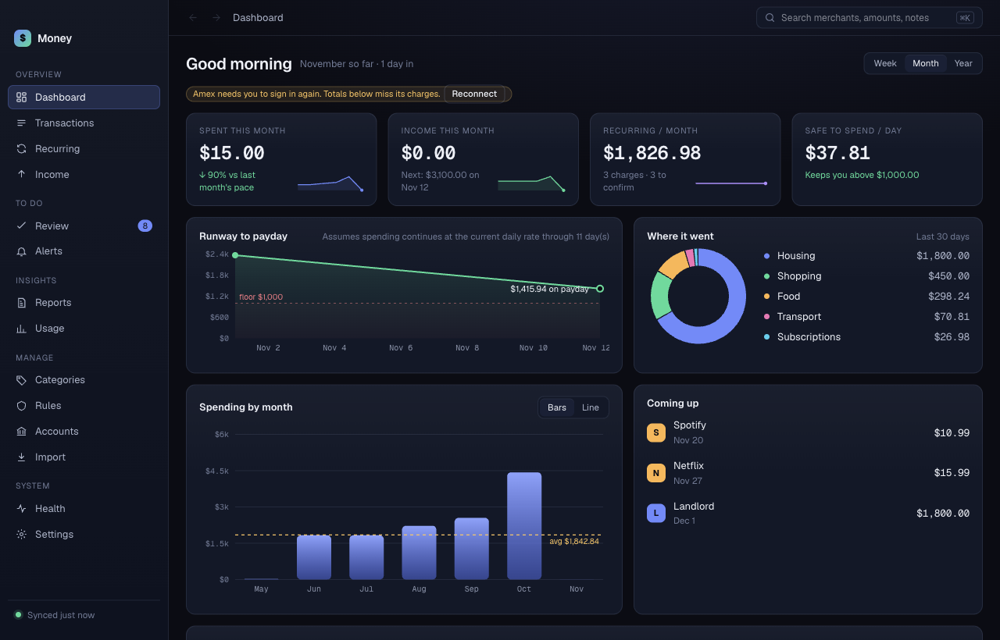

# Dashboard

The Dashboard shows where you stand. It is the first screen when you open Money. It needs no input from you.

## Read the Dashboard

From top to bottom:

- **Greeting and month line.** For example "November so far · 12 days in".
- **Data warning.** A yellow note appears when an account did not sync. Totals are then lower bounds. Click the reconnect link to go to [Accounts](accounts.md).
- **Four tiles.**
  - **Spent this month**, with a comparison to last month's pace.
  - **Income this month**, with the next expected deposit.
  - **Recurring / month**: the monthly cost of your recurring charges and how many wait for you to confirm.
  - **Safe to spend / day**: what you can spend each day and stay above your balance floor. It shows a dash until Money knows your payday.
- **Runway.** The projected balance until your next income.
- **Where it went.** A donut chart of the last 30 days by category.
- **Spending by month.** One year of monthly totals.
- **Coming up.** Recurring charges due soon.
- **By category.** Each category with its amount and transaction count.
- **What changed.** Short lines about changes since last period. It appears only when there is something to say.

## Change the period

The Dashboard has a **Week**, **Month** and **Year** switch. Click one to change the period for the tiles and the category list. The default is **Month**.

## See the transactions behind a category

1. Click a category in **By category**. Click the arrow to open its subcategories.
2. Money opens [Transactions](transactions.md) filtered to that category.

The list shows every transaction in the category. The count matches the Dashboard. Spending totals leave out money in, transfers between your own accounts, anything you excluded, and accounts not marked day-to-day.

## When a number looks wrong

- Check [Accounts](accounts.md): turn **Counts toward day-to-day spending** off for savings and investment accounts.
- Check [Health](health.md) for a sync problem.
