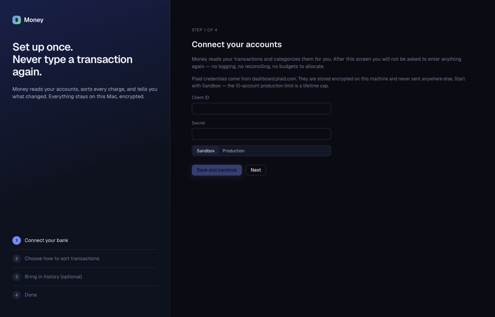

# Getting started

Money needs a Mac with an Apple Silicon chip. Setup takes about 10 minutes. You do it once.

## Install Money

1. Open the [Releases page](https://github.com/andytavares/FinStory/releases).
2. Under the newest release, download the file named `Money-<version>-arm64.dmg`.
3. Open the `.dmg` file.
4. Drag **Money** to **Applications**.
5. Open **Money** from **Applications**.

Money updates itself after this. See [Updates](updates.md).

## Get Plaid keys

Money uses Plaid to read your bank. You need a Plaid Client ID and a Secret. Follow [Plaid setup](../plaid-setup.md) to get them. Start with **Sandbox**. The Production plan has a lifetime cap of 10 connected banks.

## First launch

On the first launch Money shows the setup screen. It has four steps. The list on the left shows where you are. You can click a step in the list to go to it.

If Money shows "Money cannot start", macOS does not give Money access to the Keychain. Money will not store your data without encryption. See [Troubleshooting](troubleshooting.md).

### Step 1. Connect your bank

1. Type your **Client ID**.
2. Type your **Secret**.
3. Choose **Sandbox** or **Production** for **Environment**. The environment must match your keys.
4. Click **Save and continue**.

Money seals your keys in the macOS Keychain. Money never shows them again. See [Privacy and security](privacy-and-security.md).

### Step 2. Choose how to sort transactions

Pick one option. You can change it later in [Settings](settings.md).

| Option | What it does | What leaves your Mac |
|---|---|---|
| **Local model with Ollama** | A model on your Mac guesses categories. | Nothing. |
| **Claude** | Most accurate. Needs an Anthropic API key. | The merchant name, amount, date, and your category history for that one merchant. Never account numbers, balances, credentials or totals. |
| **Your history only** | No model. More charges go to [Review](review.md). | Nothing. |

- For Ollama: Money shows **Connected** when it finds Ollama running. Pick a model in **Model**. Click **Test with 3 sample charges** to check it. To install Ollama, see [Ollama](ollama.md).
- For Claude: paste your key in **Anthropic API key**.

Your own corrections always win over any model. The model only guesses for merchants Money has not seen.

Click **Continue**.

### Step 3. Bring in history (optional)

If you used Quicken, you can import its export after setup. The button on this step is off. Click **Skip for now**. To import later, see [Importing from Quicken](importing-from-quicken.md).

### Step 4. Done

Click **Save and finish**. Money saves your choices and opens **Accounts**.

## Connect a bank

1. On **Accounts**, click **Connect an account**.
2. Sign in to your bank in the browser window that opens. This window is Plaid's secure sign-in.
3. Return to Money. The screen updates on its own. It shows "Connected" and the number of accounts added.

Money imports your history in the background. For more, see [Accounts](accounts.md).

## First sync

1. On **Accounts**, click **Sync now**.
2. Wait for the message. It tells you what Plaid returned.
3. Open **Transactions** to see the results. Open **Dashboard** to see your month.

Money then checks for new transactions every 60 minutes while it runs. When you open it after a gap, it catches up on everything it missed.

Charges Money is unsure about go to **Review**. See [Review](review.md).
