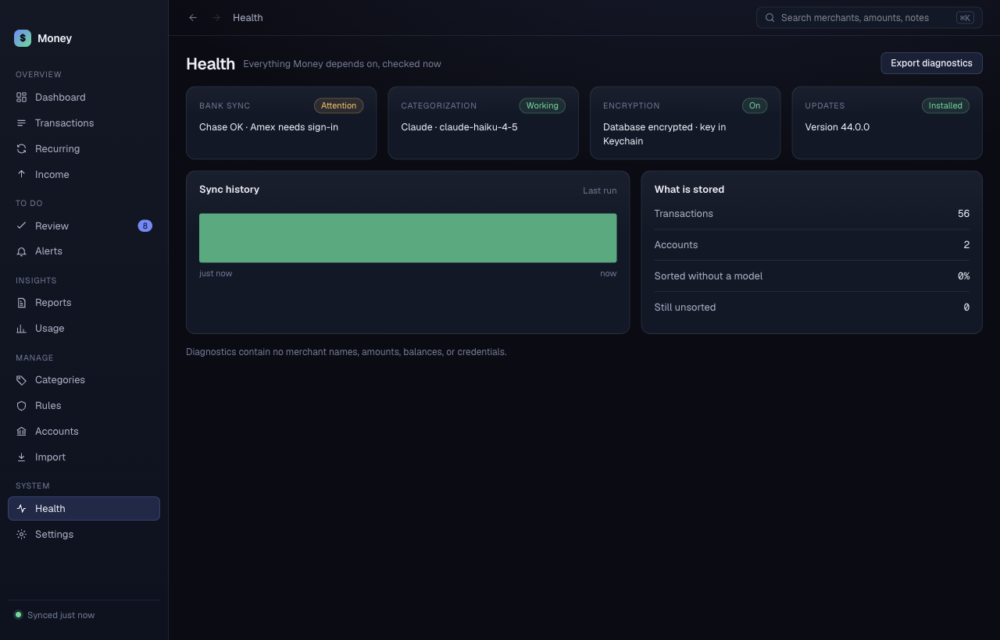

# Health

**Health** answers one question: is Money working? If not, it says why.

## The four tiles

| Tile | What it shows |
|---|---|
| **Bank sync** | Each bank, as "<bank> OK" or "<bank> needs sign-in". The chip says **Working** or **Attention**. |
| **Categorization** | Your sorting method and model. |
| **Encryption** | Whether the database is encrypted and its key is in the Keychain. The chip says **On** or **Check**. |
| **Updates** | The installed version. |

## Sync history

The bars show the last sync runs. A green bar is a run that worked. A red bar is a run that failed.

## What is stored

A list shows the number of transactions and accounts, the share sorted without a model, and the number still unsorted.

Two notes can appear here:

- "Nothing has been imported yet": go to [Accounts](accounts.md) and click **Sync now**.
- "Every imported transaction sits in an account not marked day-to-day": spending totals read zero. Turn accounts back on in [Accounts](accounts.md).

## Export diagnostics

Click **Export diagnostics**. Choose where to save `money-diagnostics.json`. The file lists events such as sync runs and errors. It has no merchant names, amounts, balances or credentials. Attach it to a bug report.
