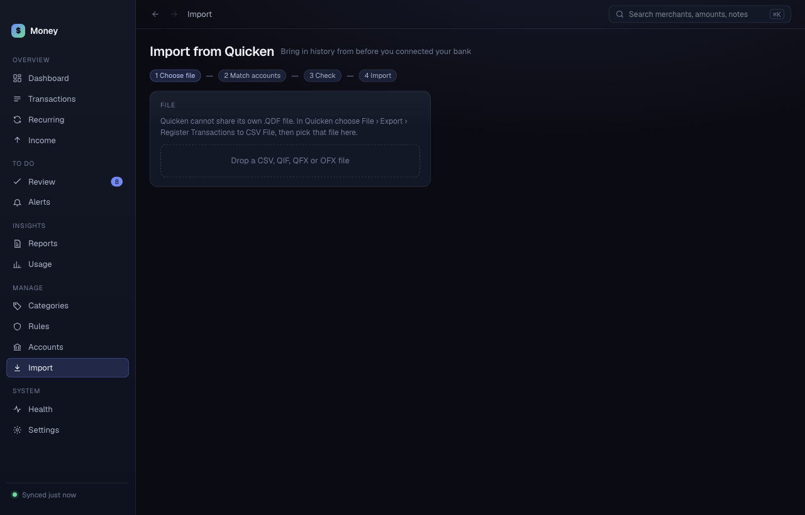

# Importing from Quicken

Import brings in history from before you connected your bank. Your Quicken categories become Money's starting point. Open **Import** in the sidebar.

## Export from Quicken

Money cannot read a Quicken `.QDF` file. That is Quicken's own format and it is not documented. Export a different file.

| Your source | What to do | File type |
|---|---|---|
| Quicken for Mac | **File › Export › Register Transactions to CSV File** | `.csv` |
| Quicken for Windows | Export a QIF file | `.qif` |
| Your bank | Download your transactions as QFX or OFX | `.qfx`, `.ofx` |

Money also reads a plain CSV from any source.

## Import a file

The screen shows four steps: **Choose file**, **Match accounts**, **Check**, **Import**.

1. Drop the file on the box, or click the box and choose the file. The box says "Drop a CSV, QIF, QFX or OFX file".
2. If the file is a CSV that Money does not recognize, Money asks "Which column is which?". Choose the **Date**, **Payee** and **Amount** columns, or **Debit** and **Credit**. Click **Read file**.
3. In **Match accounts**, choose a Money account for each account in the file. Or choose **New account: <name>**.
4. Click **Check <n> transactions**.
5. In **Check**, read the summary. Click **Import <n> transactions**.

When it finishes, Money shows how many it imported, how many duplicates it skipped, and how many accounts it created. Click **View transactions**, or **Import another file**.

## Match accounts

For each account in the file, Money shows the number of transactions and a note:

- "Added to this account": new transactions go to the account you chose.
- "<n> already imported, will skip": duplicates in that account.
- "Not day-to-day": a new account. Money leaves it out of day-to-day money. You can change this in [Accounts](accounts.md).

## Duplicates

Money skips a transaction it already has. You can import the same file twice. The **Check** step says "<n> duplicates already in Money will be skipped".

## Map categories

The chip "Your Quicken categories → mapped to <n> Money categories" opens the category list.

1. Click the chip.
2. For each Quicken category, choose a Money category. The default is **Let Money decide**.

Your corrections in Quicken become Money's first rules.

## Warnings

The **Check** step shows file warnings in yellow, for example about lines Money could not read. Read them before you click **Import**.
