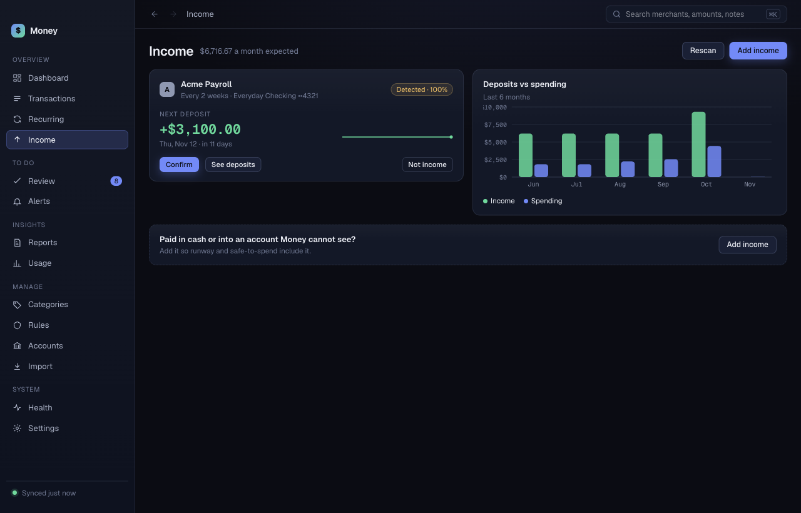

# Income

**Income** lists the deposits Money expects, such as your pay. Money uses them to project your balance and your safe daily spend. The header shows the monthly total expected.

## Read an income card

Each card shows the source, how often it pays, the next expected amount and date, and a status chip:

- **Detected · <n>%**: Money found the pattern on its own.
- **Confirmed**: you confirmed it.

The chart **Deposits vs spending** shows the last 6 months.

## Confirm or reject a source

- Click **Confirm** on a detected source that is right.
- Click **Not income** on a source that is wrong. Money stops counting it.
- Click **See deposits** to open the matching transactions.

## Add income Money cannot see

Use this for cash, a first paycheck, or an account Money is not connected to.

1. Click **Add income**.
2. Choose the account in **Paid into**.
3. Type a **Name**, for example "Freelance retainer".
4. Type the **Amount each time**.
5. Choose **How often**: weekly, biweekly, semimonthly or monthly.
6. Choose the **Next expected** date.
7. Click **Add**.

## Check again

Click **Rescan** to look for new income patterns now.

Until Money finds an income pattern, it does not project your balance. It does not guess.
