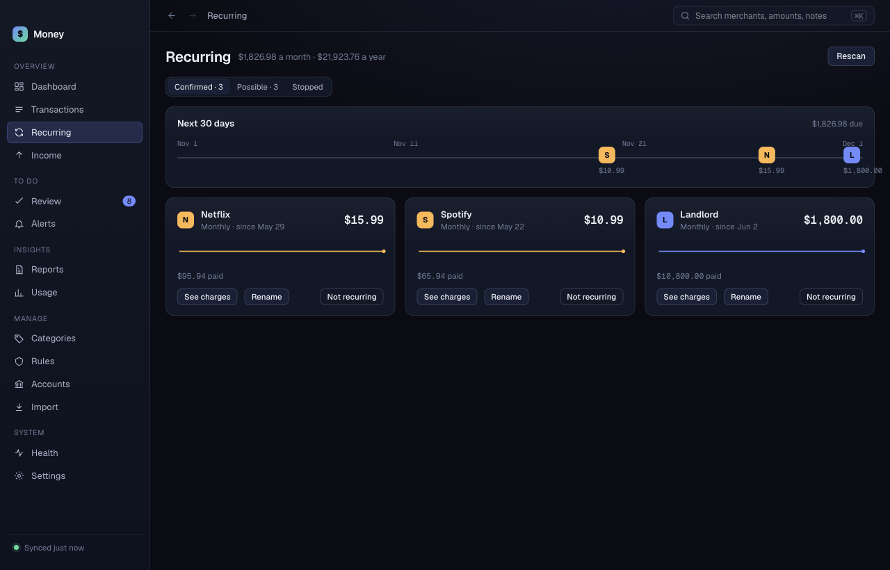

# Recurring

**Recurring** lists charges that repeat: subscriptions, rent, bills. The header shows the total cost per month and per year.

## The three tabs

- **Confirmed**: charges Money is sure repeat. A timeline at the top shows when each is due.
- **Possible**: charges that look like they repeat, waiting for your answer.
- **Stopped**: charges that have not come back.

Each Confirmed card shows the merchant, how often it bills, the price, a price history line, and the total you have paid. A yellow chip such as "Was $9.99 until Mar" shows a price rise.

## Answer a possible charge

1. Open the **Possible** tab.
2. Read the card: how many times Money saw it, the total paid, and its confidence.
3. Click **Yes, recurring** or **Not recurring**.

One answer covers every charge of that kind, including future ones. Money does not ask twice. To see the charges first, click **See transactions**.

## Mark a confirmed charge as not recurring

On a card in **Confirmed**, click **Not recurring**. The card moves to **Stopped** with the label "Marked not recurring".

## Rename a charge

On a card, click **Rename**. Type the new name and press **Return**. The new name applies to every transaction from that merchant.

## See the charges behind a card

Click **See charges**. Money opens [Transactions](transactions.md) for that merchant.

## Look for new ones

Click **Rescan**. Money checks all your transactions again and says how many recurring charges it found.
