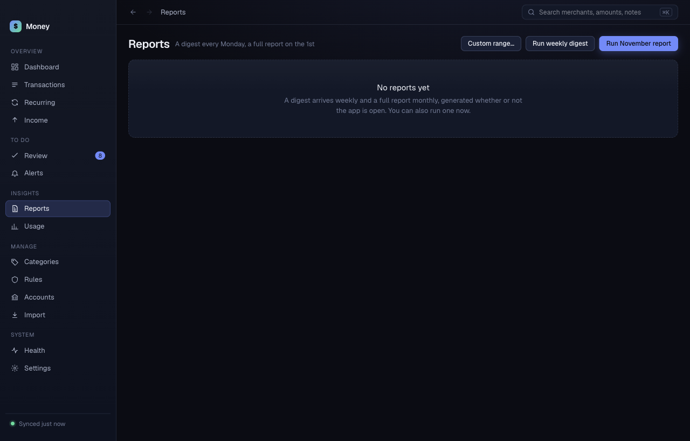
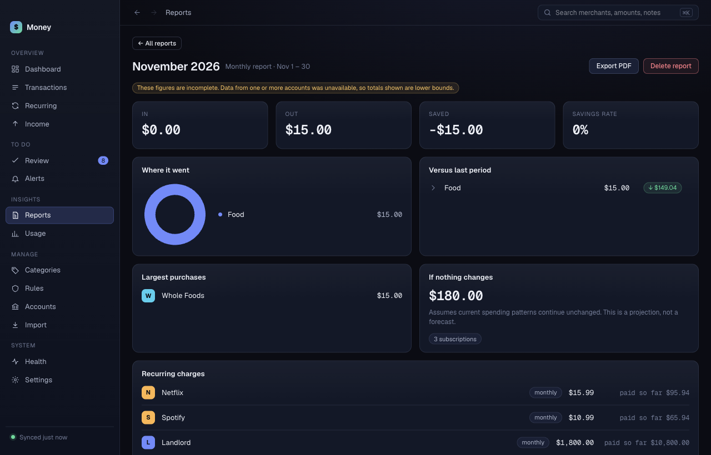

# Reports

Money writes a digest every Monday and a full report on the 1st of each month. Money writes them even when the app is closed. If the app was closed at the time, the report says "generated late".

## Open a report

- The latest report is at the top. Click **Open report**.
- Older reports are cards below. Click **Open** on a card.

## Read a report

A monthly report shows money in and out, saved and savings rate, where it went, a comparison with the last period, the largest purchases, a projection if nothing changes, and recurring charges. A weekly digest is shorter.

If an account did not sync, a yellow note says the figures are lower bounds.

Click **← All reports** to go back.

## Run a report now

- Click **Run weekly digest** to make a digest now.
- Click **Run <month> report** to make this month's report now. For example, **Run November report**.

Money shows "Weekly digest ready." or "Monthly report ready." when it is done. The new report appears at the top.

## Make a report for any dates

1. Click **Custom range…**.
2. Choose **From** and **To**.
3. Type a **Name (optional)**, for example "Trip to Japan".
4. Click **Generate**.

## Export a report as PDF

1. Open the report, or find it at the top of the list.
2. Click **Export PDF**.
3. Choose where to save the file. The save window starts in your Downloads folder.

Money then shows "Saved to <path>".

## Delete a report

Click **Delete** on a report card. You can run the report again later. The latest report has no **Delete** button.
