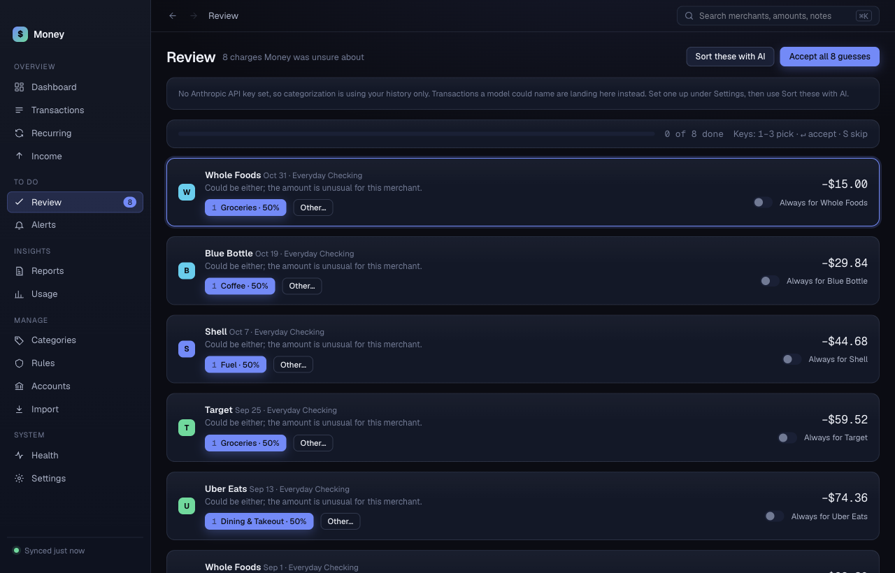

# Review

**Review** lists charges Money was not sure about. A number badge on the sidebar shows how many. Clearing the list is a short session. Most charges take one key press.

## Review one charge

Each card shows the merchant, the date, the amount, and a reason for the guess. Below that, up to three category buttons:

- Button **1** is Money's best guess, with its confidence.
- Buttons **2** and **3** are the merchant's other usual categories.

Do one of these:

- Click a category button, or press **1**, **2** or **3**. Money sets that category and removes the card.
- Press **Return** to accept the first guess as it is.
- Press **S** to skip to the next card.
- Click **Other…** and choose any category from the list.

The card with a blue ring is the active one. Keys act on it. Keys do nothing while you type in a field.

The bar at the top shows "<n> of <total> done" and the key list.

## Make a rule while you review

Turn on **Always for <merchant>** on a card, then pick a category. Money saves the category as a rule for that merchant. Future charges from it will not come back to Review. See [Rules](rules.md).

## Accept every guess

Click **Accept all <n> guesses**. Money keeps its first guess on every card and removes them from the list. Use it only when you have looked at the list.

## Sort these with AI

Click **Sort these with AI** to run your categorization model on the unresolved charges. Click **Stop** to stop. Everything done before you stop is kept.

If your sorting method is **History only**, Review shows a notice that says so. Set up a model in [Settings](settings.md) first.

## When the list is empty

Money shows "Nothing needs your review". Low-confidence charges appear here as they come in.
