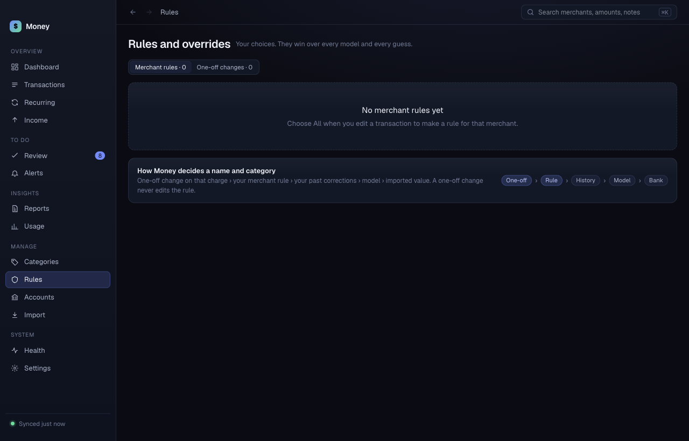

# Rules

The **Rules** screen is titled "Rules and overrides". It lists the choices you made. Your choices win over every model and every guess. It has two tabs:

- **Merchant rules**: one rule for a merchant, past and future charges.
- **One-off changes**: edits you made to a single transaction, and your recurring decisions.

## How Money decides a name and category

From strongest to weakest:

1. **One-off** change on that charge.
2. Your merchant **Rule**.
3. Your past corrections (**History**).
4. The **Model**.
5. The value from the **Bank**.

A one-off change never edits the rule. The first two steps are your own choices. A card at the bottom of the screen shows this order.

## Make a rule

Rules start in [Transactions](transactions.md): edit a charge and choose **All <merchant> (rule)**. You can also turn on **Always for <merchant>** in [Review](review.md).

## Edit a rule

1. Open **Merchant rules**.
2. Find the merchant. The table shows the **Name shown**, the **Category**, how many charges the rule **Applies to**, and **Exceptions**.
3. Click **Edit**.
4. Change the name. Change the category, or choose **No category rule**.
5. Click **Save**. Click **Cancel** to stop.

## Remove a rule

Click **Remove** on the row. The rule stops. Money decides by the next step in the order. Your transactions are not deleted.

## Undo a one-off change

1. Open **One-off changes**.
2. Find the change. Money groups them: renames, categories, excluded from totals, recurring decisions, recurring flags and notes.
3. Click **Undo**.

Each row shows the old value, an arrow and the new value, and how many transactions it covers. Undoing gives the decision back to Money. Nothing is deleted from your transaction history.
