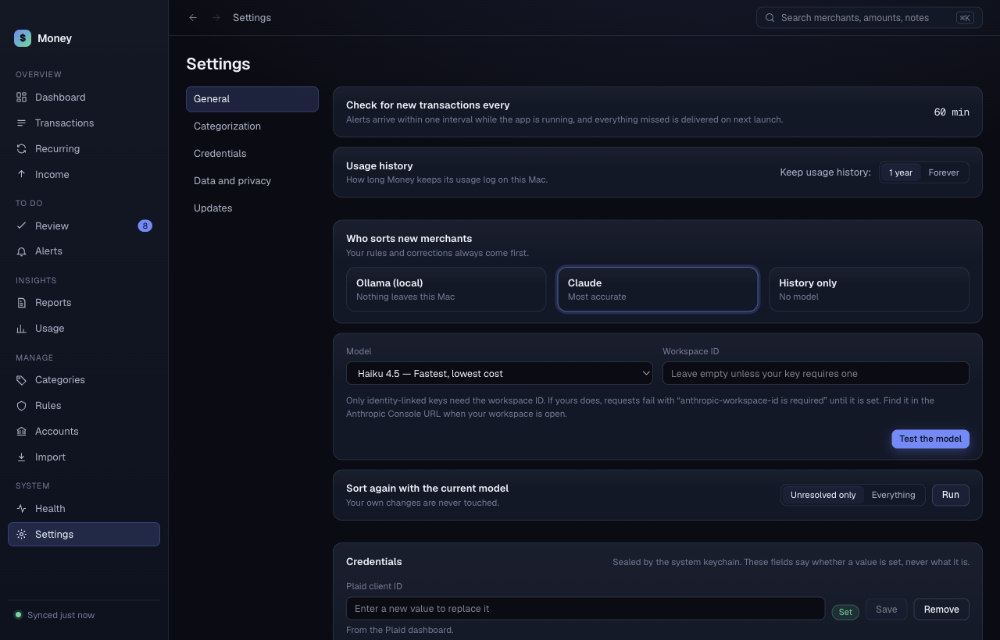
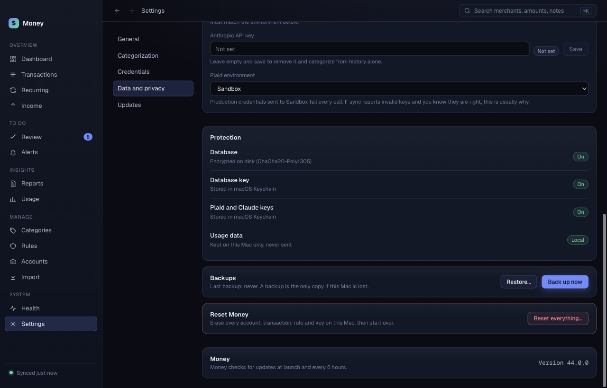

# Settings

**Settings** has five sections. Click a name in the list on the left to jump to it: **General**, **Categorization**, **Credentials**, **Data and privacy**, **Updates**. Changes save at once, except where a **Save** button is shown.

## General

- **Check for new transactions every**: shows the interval, 60 minutes by default. Alerts arrive within one interval while Money runs. Money delivers everything it missed when it next opens.
- **Keep usage history**: **1 year** or **Forever**. See [Usage](usage.md).

## Categorization

Choose **Who sorts new merchants**:

- **Ollama (local)**: nothing leaves this Mac.
- **Claude**: most accurate.
- **History only**: no model.

Your rules and corrections always come first. See [Privacy and security](privacy-and-security.md) for what each option sends.

**Claude** has two fields:

- **Model**: **Haiku 4.5** (fastest, lowest cost), **Sonnet 5** (balanced) or **Opus 5** (most accurate).
- **Workspace ID**: leave empty unless your key needs one. If requests fail with "anthropic-workspace-id is required", paste the ID from the Anthropic Console address.

**Ollama (local)** has two fields:

- **Ollama address**: the default is `http://localhost:11434`.
- **Model**: a list of the chat models you installed. See [Ollama](ollama.md). Click **Refresh models** after you install a new one.

Click **Test the model** to ask the model for a real answer. The result shows as "Last test: …". Do this after you change a key or a model. Without it, a bad key looks like a good one, because Money falls back to history when a model fails.

### Sort again

The **Sort again** card re-sorts transactions you already have, with the current model. Your own changes are never touched.

1. Choose **Unresolved only** or **Everything**.
2. Click **Run**.

**Unresolved only** sorts the charges still waiting. **Everything** sorts all charges except the ones you corrected. Click **Stop** to stop. Money keeps what it finished.

## Credentials

Shows **Plaid client ID**, **Plaid secret** and **Anthropic API key**. Each shows **Set** or **Not set**. Money never shows a saved value.

- To replace a value, type the new one and click **Save**.
- To delete a value, click **Remove**. For the Anthropic key, Money then sorts from history alone.
- **Plaid environment** must match your keys. Production keys in Sandbox fail every call. If sync says the keys are invalid and you know they are right, check this first.

## Data and privacy

**Protection** lists what is locked: the database, the database key, the Plaid and Claude keys, and usage data. Each shows a chip.

### Back up

A backup is the only copy if you lose this Mac.

1. Click **Back up now**.
2. Type a passphrase of at least 8 characters. Write it down. You need it to restore.
3. Click **Back up**.
4. Choose a folder.

Money shows "Backup saved." The card shows the date of the last backup. Money cannot recover a lost passphrase.

### Restore on a new Mac

A backup is a folder with two files: `money.sqlite` (the encrypted database) and `money.backup-key` (the database key, locked with your passphrase).

1. Install Money on the new Mac. See [Getting started](getting-started.md).
2. Copy the backup folder to the new Mac.
3. Open Money and finish the setup screen. Money needs your Plaid keys before it shows the rest of the app.
4. Open **Settings**, then **Data and privacy**.
5. Click **Restore…**.
6. Type the passphrase and click **Restore**.
7. Choose the backup folder.

Money restores the data and restarts. A wrong passphrase changes nothing.

Plaid access tokens stay in the Keychain of the old Mac. A backup does not hold them. If sync fails after a restore, click **Connect an account** in [Accounts](accounts.md) for each bank.

### Reset everything

This erases every account, transaction, rule and key on this Mac. It cannot be undone. Back up first if you want a copy.

1. Click **Reset everything…**.
2. Type `DELETE ALL MY DATA` in the box.
3. Click **Erase and restart**.

Money restarts on the setup screen.

## Updates

Shows the installed version. Money checks for updates at launch and every 6 hours. See [Updates](updates.md).
