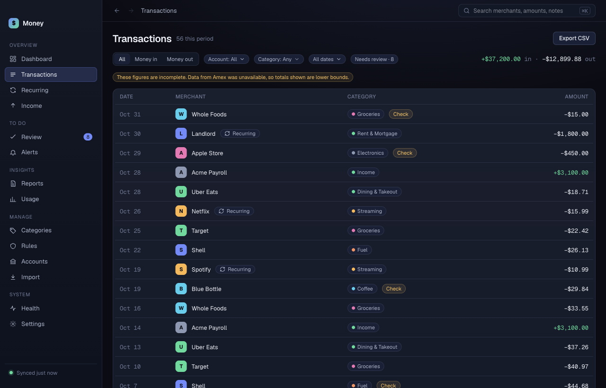
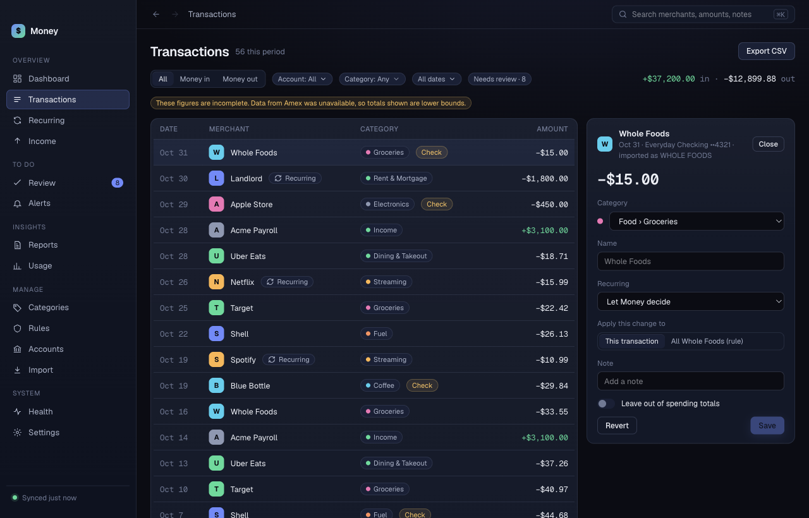

# Transactions

**Transactions** lists everything Money has imported. You can filter it, search it, edit a transaction, and export it.

## Find a transaction

Use any of these. They combine.

- **All / Money in / Money out**: show both, only deposits, or only spending.
- **Account**: pick one account.
- **Category**: pick one category.
- **All dates**: pick **This month**, **Last 30 days**, **Last 90 days** or **This year**.
- **Needs review**: show only charges Money flagged. The number is how many there are.

The top right of the list shows the total in and out for the rows on screen. Transfers between your own accounts are not counted.

## Search

1. Press **⌘K**. The cursor moves to the search box at the top.
2. Type a merchant name, an amount or a word from a note.
3. Press **Return**. Money opens Transactions with the search applied.

To clear it, click **Search: <text>** in the filter row.

## Edit a transaction in the side panel

1. Click a row. The side panel opens on the right.
2. Change **Category**, **Name** or **Note**.
3. Click **Save**. Click **Revert** to undo unsaved edits. Click **Close** to close the panel.

The panel also shows the account name and a **Recurring** field. To mark a charge as recurring, or to say it is not, change **Recurring** and click **Save**.

Your edit is stored apart from the imported data. A later sync cannot overwrite it.

### Change a category for one charge

1. Click the row.
2. Pick the category in **Category**.
3. Leave **Apply this change to** on **This transaction**.
4. Click **Save**.

Only that charge changes. If a rule already sorts the merchant, the panel says so and tells you the edit changes only this charge.

### Make a rule for a merchant

1. Click a row from the merchant.
2. Pick the category in **Category**. You can also type a new **Name**.
3. Under **Apply this change to**, choose **All <merchant> (rule)**.
4. Click **Save**.

Money applies the change to every past and future charge from that merchant. See [Rules](rules.md) to edit or remove it.

### Add a note

Type in **Note** and click **Save**. Search finds notes.

### Leave a charge out of spending totals

1. Click the row.
2. Turn on **Leave out of spending totals**.
3. Click **Save**.

The charge stays in the list. It does not count in any total, chart or report. To undo, turn the switch off. You can also undo it in [Rules](rules.md) under **One-off changes**.

## Export CSV

Click **Export CSV** at the top right. Money downloads `money-transactions.csv` with the columns Date, Merchant, Category and Amount. It contains the rows now on screen, so set your filters first.
