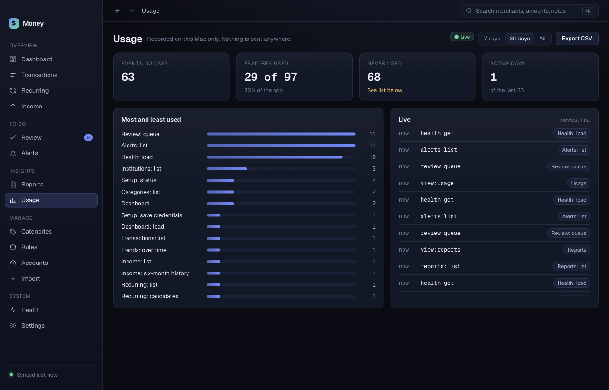

# Usage

**Usage** shows how you use Money: which screens you open and which actions you take. Money records this on your Mac only. Nothing is sent anywhere.

## What Money records

For each event Money stores:

- the feature name, for example "Transactions: edit",
- the time,
- whether it worked or failed.

Money does not store merchant names, amounts, notes or any text you type. The list of features is fixed in the app, so free text cannot reach the usage log.

Background jobs, such as a sync, are recorded too.

## Read the screen

- **Live** shows the newest events first. A **failed** chip marks an action that failed.
- **Events** counts events in the period, and compares them with the period before.
- **Features used** shows how much of the app you have used.
- **Never used** counts features you have not tried. The list is under **Most and least used**.
- **Active days** counts the days you used Money.

Click **7 days**, **30 days** or **All** to change the period.

## Keep usage history for 1 year or forever

1. Open **Settings**, then **General**.
2. Next to **Keep usage history**, click **1 year** or **Forever**.

With **1 year**, Money deletes older events. The default is 1 year.

## Export usage as CSV

Click **Export CSV**. Choose where to save `money-usage.csv`. The file holds the same event list. It stays on your Mac until you move it.
